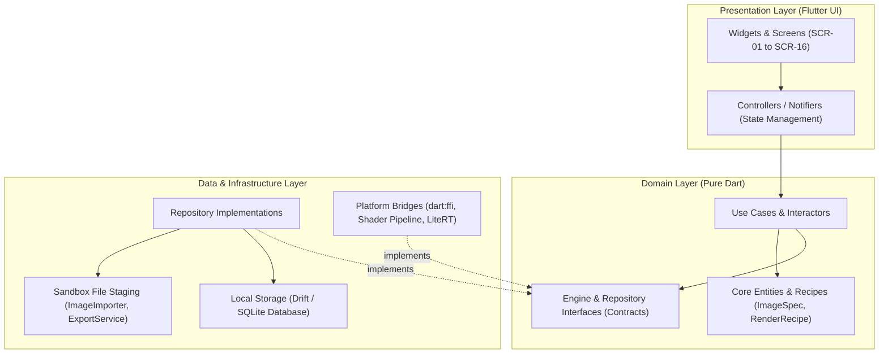

# RERANGER — SYSTEM ARCHITECTURE & INTERFACE SPECIFICATION

## 1. Architectural Mission & Clean Architecture Layering

Reranger adheres strictly to **Clean Architecture** with a layered, reactive **MVVM (Model-View-ViewModel)** presentation pattern. Dependencies flow inward toward pure domain abstractions:



### Dependency Inversion Principle
- The UI layer depends exclusively on Domain interfaces and entities.
- Low-level native libraries (`dart:ffi`, OpenCV C++ routines, LiteRT, fragment shaders) implement domain contracts.
- **Implementation Swappability:** Switching between pure-Dart, native C++ FFI, or LiteRT neural backends requires zero modifications to presentation widgets or domain use cases.

---

## 2. Core Domain Data Types & Coordinate Systems

### 2.1 Normalized Image Coordinates
All spatial operations (brush masking, crop boundaries, focal points, vignette centers) use **Normalized Device Coordinates** where $(0.0, 0.0)$ represents top-left and $(1.0, 1.0)$ represents bottom-right, independent of source image pixel dimensions:

```dart
/// Normalized 2D spatial coordinate within [0.0, 1.0].
class NormalizedPoint {
  final double x; // 0.0 (left) to 1.0 (right)
  final double y; // 0.0 (top) to 1.0 (bottom)

  const NormalizedPoint(this.x, this.y)
      : assert(x >= 0.0 && x <= 1.0, 'x out of normalized bounds'),
        assert(y >= 0.0 && y <= 1.0, 'y out of normalized bounds');
}

/// Normalized rectangular bounding box.
class NormalizedRect {
  final double left;
  final double top;
  final double width;
  final double height;

  const NormalizedRect({
    required this.left,
    required this.top,
    required this.width,
    required this.height,
  });
}
```

### 2.2 Color Representation & Math
Colors are represented as linear RGBA float vectors $[0.0, 1.0]$ for GPU fragment shader uniforms and sRGB integers for UI display:

```dart
/// Linear RGBA float vector for shader uniforms and color mathematics.
class ColorVector {
  final double r; // 0.0 to 1.0
  final double g; // 0.0 to 1.0
  final double b; // 0.0 to 1.0
  final double a; // 0.0 to 1.0

  const ColorVector(this.r, this.g, this.b, [this.a = 1.0]);

  String toHex() {
    final ri = (r * 255).clamp(0, 255).toInt();
    final gi = (g * 255).clamp(0, 255).toInt();
    final bi = (b * 255).clamp(0, 255).toInt();
    return '#${ri.toRadixString(16).padLeft(2, '0')}'
           '${gi.toRadixString(16).padLeft(2, '0')}'
           '${bi.toRadixString(16).padLeft(2, '0')}'.toUpperCase();
  }
}
```

### 2.3 Versioned Render Recipe & Non-Destructive Projects
User edits are never written directly into the source image. Instead, an immutable, versioned **Render Recipe** captures transformation parameters:

```dart
/// Immutable recipe capturing full non-destructive project state.
class RenderRecipe {
  final String recipeId;
  final int recipeVersion; // Schema migration version
  final String sourceImageHash; // SHA-256 of immutable source media
  final String sourceImagePath;
  final String activeStudio; // 'recolor' | 'style' | 'humanize'
  final String activePresetId;
  final double masterIntensity; // 0.0 to 1.0
  final Map<String, double> fineTuneParameters;
  final List<int> curveLut256;
  final List<ColorVector> paletteRemap;
  final String? maskPath;
  final DateTime updatedAt;

  const RenderRecipe({
    required this.recipeId,
    required this.recipeVersion,
    required this.sourceImageHash,
    required this.sourceImagePath,
    required this.activeStudio,
    required this.activePresetId,
    required this.masterIntensity,
    required this.fineTuneParameters,
    required this.curveLut256,
    required this.paletteRemap,
    this.maskPath,
    required this.updatedAt,
  });

  Map<String, dynamic> toJson();
  factory RenderRecipe.fromJson(Map<String, dynamic> json);
}
```

---

## 3. Structured Failure Hierarchy & Progress Signaling

```dart
/// Base application failure hierarchy.
sealed class AppFailure {
  final String message;
  final String? technicalDetails;

  const AppFailure(this.message, [this.technicalDetails]);
}

class StorageFailure extends AppFailure {
  const StorageFailure(super.message, [super.technicalDetails]);
}

class FormatFailure extends AppFailure {
  const FormatFailure(super.message, [super.technicalDetails]);
}

class RenderFailure extends AppFailure {
  const RenderFailure(super.message, [super.technicalDetails]);
}

class ModelUnavailableFailure extends AppFailure {
  final int requiredRamMb;
  final int availableRamMb;

  const ModelUnavailableFailure(super.message, {
    required this.requiredRamMb,
    required this.availableRamMb,
  });
}

class PermissionFailure extends AppFailure {
  const PermissionFailure(super.message);
}

/// Cooperative cancellation token.
class CancellationToken {
  bool _isCancelled = false;
  bool get isCancelled => _isCancelled;

  void cancel() => _isCancelled = true;
}

/// Progress notification with fractional completion and user-facing status.
class ProgressUpdate {
  final double fraction; // 0.0 to 1.0
  final String statusMessage;

  const ProgressUpdate(this.fraction, this.statusMessage);
}
```

---

## 4. Typed Modular Engine & Repository Interfaces

### 4.1 `ImageImporter` (Media Import & Staging)
```dart
abstract interface class ImageImporter {
  /// Opens an image via private photo picker, verifies format/integrity,
  /// generates internal read-only staging copy, and computes SHA-256.
  Future<ImageStagingResult> importFromPicker();

  /// Validates file byte headers against supported formats (JPEG, PNG, WebP).
  Future<bool> validateFormat(String filePath);

  /// Computes SHA-256 checksum of source file.
  Future<String> computeChecksum(String filePath);
}

class ImageStagingResult {
  final String originalPath;
  final String stagedPath;
  final String sha256Hash;
  final int width;
  final int height;

  const ImageStagingResult({
    required this.originalPath,
    required this.stagedPath,
    required this.sha256Hash,
    required this.width,
    required this.height,
  });
}
```

---

### 4.2 `AnalysisEngine` (Histogram & Palette Extraction)
```dart
abstract interface class AnalysisEngine {
  /// Extracts the top N dominant colors from the image using K-means clustering.
  Future<List<ColorVector>> extractPalette(
    String imagePath, {
    int colorCount = 5,
    CancellationToken? token,
  });

  /// Computes 256-bin RGB and Luminance histograms.
  Future<HistogramData> computeHistogram(
    String imagePath, {
    CancellationToken? token,
  });
}

class HistogramData {
  final List<int> luminance;
  final List<int> red;
  final List<int> green;
  final List<int> blue;

  const HistogramData({
    required this.luminance,
    required this.red,
    required this.green,
    required this.blue,
  });
}
```

---

### 4.3 `SceneMapRepository` (Masks & Spatial Layers)
```dart
abstract interface class SceneMapRepository {
  /// Persists a touch-drawn or model-generated mask bitmap to project storage.
  Future<String> saveMask(String projectId, List<int> maskBytes);

  /// Retrieves mask byte stream for shader binding.
  Future<List<int>?> loadMask(String maskPath);

  /// Deletes associated mask when variant is discarded.
  Future<void> deleteMask(String maskPath);
}
```

---

### 4.4 `RenderEngine` (GPU Viewport Shader & Native Rendering)
```dart
abstract interface class RenderEngine {
  /// Configures GPU fragment shader uniforms for live 60 FPS viewport preview.
  void updateViewportUniforms(RenderRecipe recipe);

  /// Renders high-resolution image non-destructively in background isolate.
  Future<String> renderHighResolution({
    required RenderRecipe recipe,
    required String destinationPath,
    required OutputFormat format,
    required int quality, // 1 to 100
    CancellationToken? token,
    void Function(ProgressUpdate)? onProgress,
  });

  /// Releases native GPU/CPU resources on project exit.
  void dispose();
}

enum OutputFormat { jpeg, png, webp }
```

---

### 4.5 `PresetCatalog` (Canonical Presets Access)
```dart
abstract interface class PresetCatalog {
  /// Returns all 48 canonical presets grouped by category.
  List<PresetDefinition> getAllPresets();

  /// Returns presets filtered by studio mode ('recolor' | 'style' | 'humanize').
  List<PresetDefinition> getPresetsForStudio(String studio);

  /// Retrieves specific preset definition by ID.
  PresetDefinition? getPresetById(String presetId);
}

class PresetDefinition {
  final String id;
  final String name;
  final String category;
  final String studio;
  final String assetThumbnailPath;
  final Map<String, double> defaultUniforms;
  final bool isQualityGated;

  const PresetDefinition({
    required this.id,
    required this.name,
    required this.category,
    required this.studio,
    required this.assetThumbnailPath,
    required this.defaultUniforms,
    this.isQualityGated = false,
  });
}
```

---

### 4.6 `ProjectRepository` (Local Persistence & Recovery)
```dart
abstract interface class ProjectRepository {
  /// Saves or updates a project recipe and history tree in local SQLite.
  Future<void> saveProject(ProjectEntity project);

  /// Loads project by unique ID.
  Future<ProjectEntity?> loadProject(String projectId);

  /// Lists all recent projects for Home Gallery.
  Future<List<ProjectSummary>> getRecentProjects();

  /// Records atomic journal snapshot for crash recovery.
  Future<void> writeDirtyJournal(String projectId, RenderRecipe recipe);

  /// Checks for unsaved crash recovery state on launch.
  Future<RenderRecipe?> checkDirtyJournal();

  /// Clears dirty journal on clean exit or export.
  Future<void> clearDirtyJournal();

  /// Deletes project recipe and associated cache.
  Future<void> deleteProject(String projectId);
}
```

#### Persistence Subsystem Implementation (`lib/data/local/`):
- `ProjectDatabase`: SQLite relational engine with versioned migration support (`PRAGMA user_version`), WAL mode, and atomic crash recovery journaling (`dirty_journal`).
- `AtomicFileWriter`: Non-destructive file write pipeline with temporary sibling buffering, SHA-256 verification, and strict source image immutability guards.
- `ProjectFileStorage`: Manages app-private project sandbox directory trees (`projects/<id>/[source, masks, outputs, cache]`), orphan cleanup, and file corruption detection.
- `LocalProjectRepository`: Coordinates database records and sandboxed file storage to deliver resilient offline persistence.
- Project Format Specification: Fully defined in [`docs/PROJECT_FORMAT.md`](file:///root/reranger/docs/PROJECT_FORMAT.md).

---

### 4.7 `ExportService` (File Encoding & Media Store Publishing)
```dart
abstract interface class ExportService {
  /// Publishes rendered image to public Android MediaStore (Pictures/Reranger)
  /// preserving original EXIF metadata.
  Future<ExportResult> publishToGallery({
    required String renderedFilePath,
    required String originalSourcePath,
  });

  /// Verifies available storage headroom before export ($> 100 MB$).
  Future<bool> hasStorageHeadroom(int requiredBytes);
}

class ExportResult {
  final String publicUri;
  final String sha256Checksum;
  final int fileSizeBytes;

  const ExportResult({
    required this.publicUri,
    required this.sha256Checksum,
    required this.fileSizeBytes,
  });
}
```

---

### 4.8 `ModelCatalog` (Neural Model Asset Lifecycle)
```dart
abstract interface class ModelCatalog {
  /// Checks local availability and SHA-256 hash of on-device neural models.
  Future<ModelStatus> getModelStatus(String modelId);

  /// Returns total disk footprint of downloaded model assets.
  Future<int> getModelsDiskUsage();

  /// Purges optional diffusion model weights to reclaim storage.
  Future<void> deleteModelWeights(String modelId);
}

enum ModelStatus { bundled, downloaded, notDownloaded, incompatible }
```

---

### 4.9 `HumanizeEngine` (On-Device Perception & ML Inference — Conditional)
```dart
abstract interface class HumanizeEngine {
  /// Probes host hardware for NNAPI/GPU delegate support and RAM budget.
  Future<HardwareCapability> probeCapability();

  /// Executes on-device segmentation / plastic glaze reduction pass.
  Future<String> runDeSynthesizePass({
    required String inputImagePath,
    required double intensity,
    required String mode,
    CancellationToken? token,
    void Function(ProgressUpdate)? onProgress,
  });

  /// Releases model tensor buffers from memory.
  void unloadModel();
}

class HardwareCapability {
  final bool isSupported;
  final int totalRamMb;
  final int availableRamMb;
  final bool hasGpuDelegate;
  final String statusReason;

  const HardwareCapability({
    required this.isSupported,
    required this.totalRamMb,
    required this.availableRamMb,
    required this.hasGpuDelegate,
    required this.statusReason,
  });
}
```

---

## 5. Technology Swap Strategy (OpenCV / ML Runtimes)
To swap underlying image processing engines without altering presentation or use cases:
1. **Engine Injection:** `RenderEngine` and `AnalysisEngine` are registered as abstract domain contracts in the dependency container (Riverpod `Provider`).
2. **Current Baseline Implementation:**
   - Real-time Viewport: `FlutterShaderRenderEngine` (GPU GLSL).
   - Analysis: `IsolateDartAnalysisEngine` (background Dart compute).
   - Export: `IsolateDartExportEngine` (`package:image`).
3. **Future Native Swap:**
   - Swapping in `NativeFfiRenderEngine` (C++/OpenCV) or `LiteRtHumanizeEngine` only requires providing a new implementation of `RenderEngine` or `HumanizeEngine` in the dependency injection container.
   - Zero UI widget code changes.

---

## 6. Provisional Technology Labels & PoC Gating
The following architectural choices are explicitly marked **PROVISIONAL** until verified in corresponding vertical slice proof gates:
- **`flutter_riverpod` (v3.4.x):** Chosen for compile-safe reactive state management; provisional until Prompt 07 bootstrap tests.
- **`go_router` (v18.1.x):** Chosen for declarative routing and deep linking; provisional until navigation smoke test.
- **`drift` (v2.35.x) + SQLite:** Chosen for type-safe local project recipe persistence; provisional until persistence benchmark.
- **`flutter_litert` (v3.9.x):** Provisional and strictly gated behind Gate B hardware validation.
