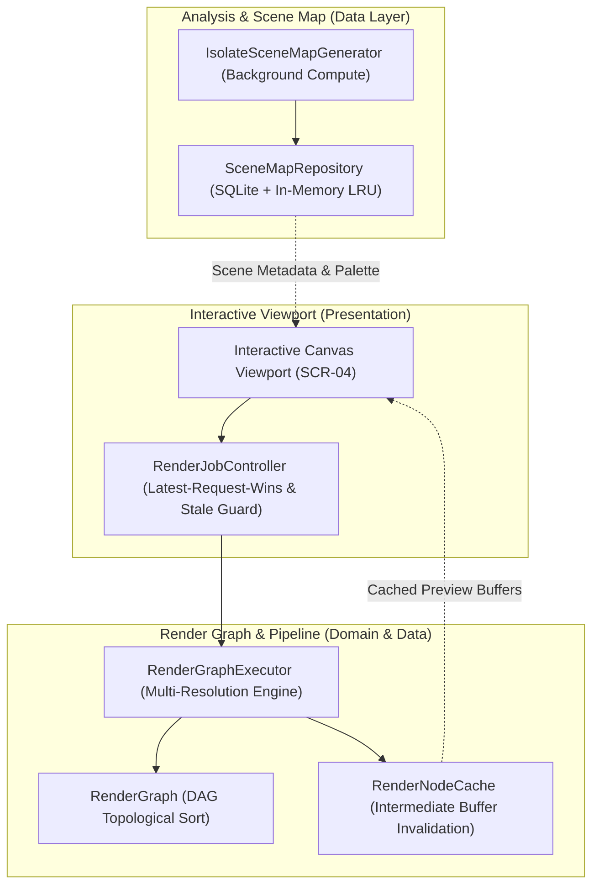

# RERANGER — IMAGE TRANSFORMATION & RENDERING ENGINE SPECIFICATION

**Document Version:** 1.1.0  
**Status:** **APPROVED SPECIFICATION & CONTRACT**  
**Associated Prompts:** Prompt 07/08 (Feasibility PoC), Prompt 14 (Scene Map), Prompt 15 (Render Graph & Job Control), Prompt 16 (Canvas Viewport)  
**Cross-References:** [`docs/SCENE_MAP_SPEC.md`](file:///root/reranger/docs/SCENE_MAP_SPEC.md), [`docs/ARCHITECTURE.md`](file:///root/reranger/docs/ARCHITECTURE.md), [`AGENTS.md`](file:///root/reranger/AGENTS.md)

---

## 1. Engine Mission & Tiered Architectural Strategy

The Reranger Rendering Engine is responsible for real-time interactive preview rendering, background project analysis, and high-fidelity final artifact export. To guarantee 60 FPS viewport interactivity on mid-tier Android devices while adhering to tight memory constraints, the engine implements a **Tiered Hybrid Architecture**:

1. **Interactive Viewport (60–120 FPS):** Powered by GPU GLSL fragment shaders (`dart:ui` `FragmentProgram`) and the asynchronous [`RenderJobController`](file:///root/reranger/lib/data/render/render_job_controller.dart) on the Flutter raster and worker threads.
2. **Analysis & Visual Understanding:** Powered by background Dart isolates (`IsolateSceneMapGenerator`) producing versioned [`SceneMapBundle`](file:///root/reranger/docs/SCENE_MAP_SPEC.md) artifacts cached in SQLite.
3. **High-Resolution Final Export:** Full-resolution pipeline executing in isolated threads, preserving 100% of user media quality without modifying input source files.

---

## 2. Render Graph Architecture (v1.0.0)

A [`RenderGraph`](file:///root/reranger/lib/domain/recipes/render_graph.dart) is a versioned Directed Acyclic Graph (DAG) consisting of typed, validated nodes. It guarantees:
- **Acyclicity:** Cycles are detected via Kahn's topological sort and rejected with `RenderGraphCycleFailure`.
- **Dependency Integrity:** Missing input dependencies trigger `RenderGraphMissingInputFailure`.
- **Deterministic Evaluation:** Nodes execute in strict topological order from source roots to `outputNodeId`.
- **Memory Footprint Estimation (Invariant 11):** `estimatePeakMemoryBytes(w, h)` calculates the required RAM headroom prior to execution.

### Validated Node Taxonomy
| Node Type | Operation ID | Mathematical Formula | Inputs | Parameters |
|---|---|---|---|---|
| [`SourceImageNode`](file:///root/reranger/lib/domain/recipes/render_graph_node.dart) | OP-01 | Immutable source media ingestion | None (Root) | `sourceImageHash` (64-char SHA-256), `sourceWidth`, `sourceHeight` |
| [`GrayscaleNode`](file:///root/reranger/lib/domain/recipes/render_graph_node.dart) | OP-02 | BT.601 integer luminance: $Y = (299R + 587G + 114B)/1000$ | 1 node | `preserveAlpha` (bool) |
| [`SobelEdgeNode`](file:///root/reranger/lib/domain/recipes/render_graph_node.dart) | OP-03 | 3x3 Sobel gradient magnitude convolution | 1 node | `edgeThreshold` (0..255), `invertOutput` (bool) |
| [`EdgeInvertSubtractNode`](file:///root/reranger/lib/domain/recipes/style_render_nodes.dart) | Recipe 1 | $G_{ink} = \text{clamp}(G_{gray} - \text{intensity} \cdot G_{edge}, 0, 255)^\gamma$ | 2 nodes | `edgeIntensity` (0.0..1.0), `contrastGamma` (0.1..5.0) |
| [`GrainOverlayNode`](file:///root/reranger/lib/domain/recipes/style_render_nodes.dart) | OP-07 | 32-bit Linear Congruential PRNG noise overlay | 1 node | `intensity` (0.0..1.0), `seed` (int >= 0) |
| [`DuoToneNode`](file:///root/reranger/lib/domain/recipes/style_render_nodes.dart) | Recipe 3 | Shadow/highlight remapping with quadratic radial vignette | 1 node | `shadowRGB`, `highlightRGB`, `vignetteFalloff` (0.0..1.0) |

---

## 3. Intermediate Buffer Caching & Downstream Invalidation

[`RenderNodeCache`](file:///root/reranger/lib/data/render/render_node_cache.dart) stores raster outputs keyed by each node's deterministic SHA-256 key:
$$\text{NodeKey} = \text{SHA256}\left(\text{"type:"} + \text{type} + \text{"|v:"} + v + \text{"|dim:"} + W \times H + \text{"|up:["} + \text{upstreamKeys} + \text{"]|params:["} + \text{sortedParams} + \text{"]"}\right)$$

### Downstream Invalidation Rule
When any parameter or input changes on node $N$:
1. $N$'s cache key changes, causing a cache miss on $N$.
2. All downstream dependent nodes in the DAG transitively depend on $N$'s key, causing automatic cache misses and re-evaluation downstream.
3. Unaffected sibling or upstream branches remain cached, delivering sub-millisecond updates during slider adjustments.

---

## 4. Render Job Controller: Concurrency & Stale-Result Protection

Interactive sliders can trigger dozens of render requests per second. [`RenderJobController`](file:///root/reranger/lib/data/render/render_job_controller.dart) manages execution using four deterministic concurrency mechanisms:
1. **Latest-Request-Wins:** Each incoming request increments `_latestRequestId`. Prior in-flight jobs receive a cancellation signal.
2. **Stale-Result Guard:** If an asynchronous render job completes after a newer request has been registered (`assignedRequestId < _latestRequestId`), its result is flagged as stale and discarded. Stale results **never** overwrite newer previews.
3. **Buffer Mutex Serialization:** Async mutex guarantees that shared pixel and model memory buffers are accessed sequentially, preventing race conditions or memory corruption.
4. **Truthful Progress Reporting (Invariant 7):** Progress is emitted via `stateStream` strictly as discrete node completions ($N / \text{total}$). Zero fake percentages or artificial delays.
5. **Visible Cancel Action:** `cancelCurrentJob()` provides immediate user cancellation.

---

## 5. Viewport Contract for Prompt 16 (Canvas Viewport)

1. **Coordinate Transform:** Viewport consumes [`CoordinateTransform`](file:///root/reranger/lib/domain/scene_map/coordinate_transform.dart) for letterbox/pillarbox layout (`calculateFitLayout`) and touch point normalization.
2. **Preview Mode:** Viewport triggers `RenderJobController.submitRenderRequest(renderScale: 0.5)` for interactive slider feedback, and `renderScale: 1.0` upon gesture release.
3. **Overlays:** Structural vector inking rendered from `ContourMapData.contours`.
