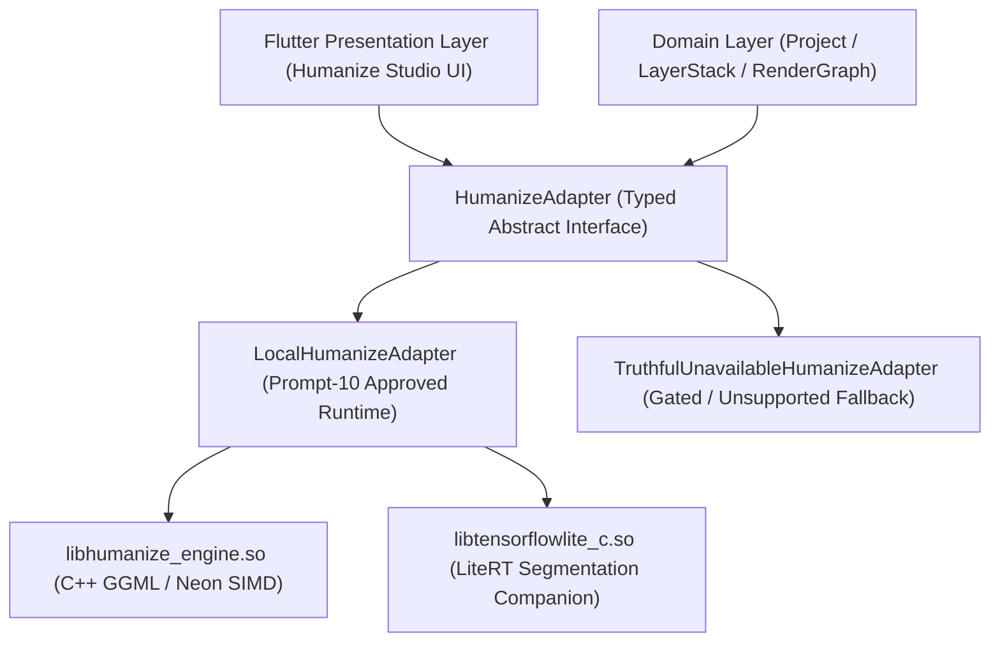

# RERANGER — HUMANIZE ADAPTER ARCHITECTURAL SPECIFICATION & CONTRACT

**Document Version:** 1.0.0  
**Status:** ACTIVE CONTRACT (PROMPT 20 APPROVED)  
**Governance Invariants:**  
- **Invariant 4 (Source Image Immutability):** Original user media is strictly read-only and never overwritten.
- **Invariant 5 (100% Offline-First Runtime):** All inference executes locally on-device without network calls.
- **Invariant 6 (Zero Cloud / Telemetry):** Zero server-side offloading, analytics SDKs, or cloud accounts.
- **Invariant 7 (No Fake Controls or Illusory AI):** Every control maps to verified computation; zero placebo noise or simulated AI states.
- **Invariant 9 (Proof-Gated ML):** On-device neural models require verified hardware latency, memory headroom, and quantization proofs.
- **Invariant 10 (Model Provenance & Licensing):** Zero unlicensed weights; strict SHA-256 verification and OpenRAIL-M / Apache-2.0 compliance.
- **Invariant 11 (Strict Memory & Thermal Budgets):** Peak RSS must avoid Android `lowmemorykiller` OOM kills.

---

## 1. Architectural Mission & Decoupling Strategy

The Humanize Studio provides local, on-device neural refinement to transform synthetic, plastic AI-generated art into authentic, natural aesthetics while preserving user likeness, composition, and framing.

To prevent high-level domain, project persistence, and Flutter UI layers from coupling directly to low-level native runtime libraries (such as `stable-diffusion.cpp`, Google LiteRT, ONNX Runtime, or platform NPU drivers), Reranger mandates a strictly typed adapter pattern:

### Key Architectural Guarantees:
1. **Zero UI Leaks:** Flutter widgets only interact with `HumanizeAdapter`, receiving typed status, progress, capability, and error events.
2. **Truthful Gating:** When hardware memory is insufficient ($< 6\text{ GB}$ RAM) or model weights are missing, the system instantiates `TruthfulUnavailableHumanizeAdapter`. It explicitly discloses why the feature is unavailable and disables invocation, eliminating fake spinners or placebo grain (Invariant 7).
3. **Cooperative Cancellation & Mutex Locking:** Heavy native compute loops run in background workers/isolates with cancellation checkpoints and mutex locks preventing reentrant memory crashes.

---

## 2. Hardware Tier Classification & Memory Headroom

To satisfy **Invariant 11** and safeguard Android devices from `lowmemorykiller` kills, the adapter evaluates total system RAM:

| Hardware Tier | Total System RAM | Maximum Resolution | Latent Grid | Inference Strategy | Action on Background |
|---|---|---|---|---|---|
| **Flagship Supported** | $\ge 8\text{ GB}$ | $512 \times 512$ | $64 \times 64 \times 4$ | Full SD 1.5 Q4_0 + LCM LoRA (6 steps) | Retain base model; release VAE cache |
| **Constrained Supported** | $6\text{ GB} \le \text{RAM} < 8\text{ GB}$ | $384 \times 384$ | $48 \times 48 \times 4$ | Downscaled latents + aggressive memory freeing | Immediate full model unload |
| **Unsupported OOM Risk** | $< 6\text{ GB}$ | None | None | Studio disabled; honest UI notice displayed | N/A |

---

## 3. Cryptographic Model Provenance Verification

Before loading any model binary into native memory, the adapter verifies its file existence and SHA-256 cryptographic digest against the authoritative registry in [docs/MODEL_PROVENANCE.md](file:///root/reranger/docs/MODEL_PROVENANCE.md):

- **Base Diffusion Model (`MOD-SD15-Q4`):**  
  File: `v1-5-pruned-emaonly-Q4_0.gguf`  
  SHA-256: `6ce0161c80f35f3a32f60271f4b444b084eabab343e0618ff7e4ebff8f328f41`  
  License: CreativeML OpenRAIL-M
- **Acceleration LoRA (`MOD-LCM-LORA`):**  
  File: `lcm-lora-sdv1-5.gguf`  
  SHA-256: `1e9a7e6b093f18b5b5c92c89f5bc8c3e8a4d7d912e4b3701a8ef15d2a02b1f8c`  
  License: Apache-2.0 / CreativeML OpenRAIL-M
- **Segmentation Companion (`MOD-SEG-SELFIE`):**  
  File: `selfie_multiclass_256x256.tflite`  
  SHA-256: `9fa1650b28e67e3dfd3b07ca614a92c303f2e7b8a7fa950cb38f2b7ea67280e5`  
  License: Apache-2.0

Any hash mismatch or truncated file immediately throws `ModelCorruptedException`.

---

## 4. Source Conditioning & Mathematical Bounds

Humanize Studio is strictly an **Image-to-Image** (`img2img`) refinement engine:
1. Source image $x_0 \in \mathbb{R}^{H \times W \times 4}$ is encoded into latent space $z_0 = \mathcal{E}(x_0)$.
2. User strength $s \in [0.0, 1.0]$ scales forward noise perturbation:
   $$t = \text{round}(T \times s)$$
   $$z_t = \sqrt{\bar{\alpha}_t} z_0 + \sqrt{1 - \bar{\alpha}_t} \epsilon, \quad \epsilon \sim \mathcal{N}(0, \mathbf{I})$$
3. Low-step solver (LCM) reconstructs refined latents $\hat{z}_0$.
4. Composition preservation check: For beginner presets ($s \le 0.35$), the structural Mean Absolute Error (MAE) residual between source and output must satisfy:
   $$0.01 < \text{MAE}(x_0, \hat{x}_0) < 0.15$$
   This guarantees authentic micro-texture synthesis while prohibiting compositional drift.

---

## 5. Lifecycle Management & Concurrency Protections

1. **Explicit Initialization:** Model weights are not loaded on app startup. Loading is triggered explicitly upon entering Humanize Studio or initiating a self-test.
2. **Single-Inference Mutex:** Simultaneous inference requests are rejected with `ConcurrentInferenceException`.
3. **Cooperative Cancellation:** The adapter checks the `CancellationToken` at every step:
   - Prior to VAE encoding
   - Between each diffusion solver iteration ($k=1 \dots N$)
   - Prior to VAE decoding
   Upon cancellation, all intermediate tensors are cleared and `InferenceCancelledException` is thrown.
4. **App Lifecycle Integration:** On Android `AppLifecycleState.paused` or OS memory pressure warnings (`onTrimMemory`), the adapter automatically unloads cached weights.
