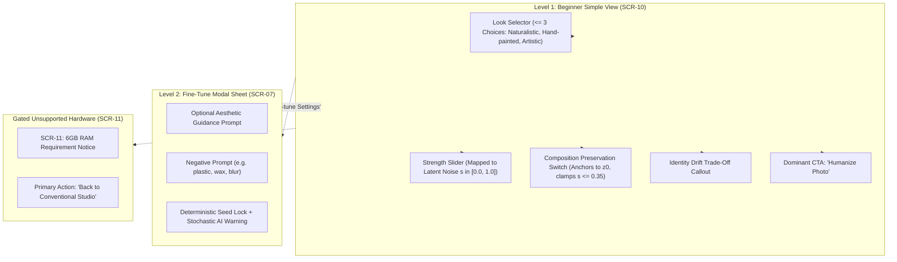

# RERANGER — HUMANIZE STUDIO UX SPECIFICATION & QUALITY GUARDRAILS

**Document Version:** 1.0.0  
**Status:** ACTIVE SPECIFICATION (PROMPT 21 APPROVED)  
**Role:** Beginner-First Designer & ML Product QA Reviewer  
**Governance Invariants:**  
- **Invariant 3 (Beginner-First Progressive Disclosure):** Single-tap intuitive defaults; granular controls progressively disclosed under Fine-tune.
- **Invariant 4 (Source Image Immutability):** Original user media is strictly read-only and never overwritten.
- **Invariant 5 (100% Offline-First Runtime):** All inference executes locally on-device without network telemetry.
- **Invariant 7 (No Fake Controls or Illusory AI):** Every exposed UI element maps to a real underlying implementation.
- **Invariant 11 (Strict Memory & Thermal Budgets):** Hardware gating protects Android devices from OOM kills.

---

## 1. Studio Identity & Core User Value

The Humanize Studio allows digital artists, photographers, and AI-art creators to refine synthetic, overly smooth, or plastic AI-generated imagery into authentic, natural aesthetics while preserving likeness, composition, and framing.

### The Fundamental Quality Guardrail (No Deceptive Claims):
Reranger explicitly rejects misleading marketing claims:
1. **No "Undetectable AI" Guarantee:** The app never claims that outputs are guaranteed to deceive AI detectors or be indistinguishable from human artwork.
2. **Identity Trade-Off Disclosure:** The UI explicitly warns users that higher transformation strength ($s > 0.35$) alters fine facial geometries, micro-features, and subject identity.
3. **Source Conditioning Anchor:** Beginners are guided to keep Composition Preservation enabled to anchor the latent diffusion trajectory to the source image $z_0$.

---

## 2. Progressive Disclosure Architecture



---

## 3. Plain-Language Look Presets (Level 1)

Reranger exposes exactly three verified plain-language looks:

| Look Preset | Target Aesthetic | Default Latent Strength ($s$) | Composition Preservation | Expected MAE Residual |
|---|---|---|---|---|
| **Naturalistic** | De-glazes plastic skin, introduces organic skin micro-texture and subtle film halation. | $0.20$ | Forced ON | $0.015 - 0.050$ (High likeness) |
| **Hand-painted** | Softens photographic edges, introduces painterly brush texture and tactile canvas tooth. | $0.35$ | ON (Recommended) | $0.050 - 0.110$ (Likeness anchored) |
| **Artistic Reinterpretation** | Expressive stylistic re-synthesis with richer lighting gradients and dynamic textures. | $0.55$ | OFF (User choice) | $0.110 - 0.220$ (Identity drift warning) |

---

## 4. State Machine & Authentic Feedback

The Humanize UI transitions across authentic, observable states:

```
[Initial / Idle]
       │
       ▼ (Tap "Humanize Photo")
[Checking Hardware & Model Integrity]
       ├─────────────────────────────────────────┐
       ▼ (RAM < 6GB or Model Missing)             ▼ (Verified >= 6GB RAM & Valid Weights)
[SCR-11: Truthful Compatibility Card]     [Loading Model Weights (Offline)]
       │ (User taps "Back to Studio")             ▼
       └─────────► [Return to Recolor/Style] [Running Denoising (Step k/N)]
                                                  ├───────────────┐
                                                  ▼ (Tap Cancel)  ▼ (Inference Complete)
                                             [Cancelled]     [Completed Preview]
                                                  │               │
                                                  ▼               ▼
                                             [Idle State]    [Compare & Export View]
```

### State Specifications:
1. **Model Loading:** Displays indeterminate spinner with honest text: *"Preparing on-device neural model (100% offline)..."*.
2. **Denoising Running:** Displays authentic stage indicator (`Encoding Latents` $\rightarrow$ `Denoising Step k of N` $\rightarrow$ `Decoding Latents`), active fraction bar, and a prominent `Cancel` button.
3. **Cancellation:** Tapping `Cancel` terminates inference within $< 50\text{ ms}$, discards transient latents, and restores the viewport cleanly.
4. **Unsupported Device (SCR-11):** Non-blocking informational card explaining the 6GB physical RAM threshold. The primary CTA smoothly routes back to conventional tools (Recolor Studio & Style Studio).

---

## 5. Viewport Split Comparison

The viewport provides before/after verification:
- **Hold-to-Compare:** Pressing the canvas immediately displays the immutable source image with an `ORIGINAL (BEFORE)` badge.
- **Release:** Instantly returns to the humanized result.
- **Split Curtain Slider:** Draggable divider dividing original and humanized passes at 60 FPS.
