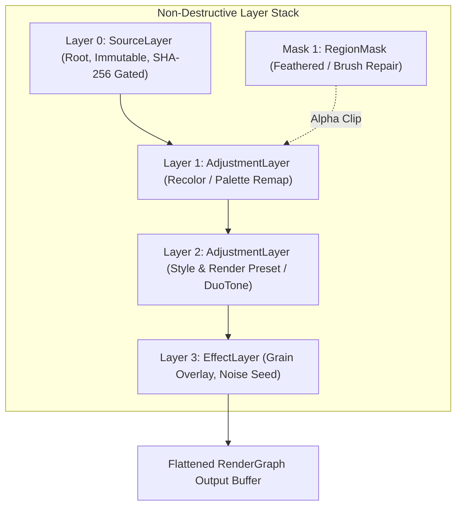

# RERANGER — LAYER, HISTORY, AND VARIANT SPECIFICATION (GATE C1)

**Document Version:** 1.0.0  
**Status:** **APPROVED SPECIFICATION & CONTRACT**  
**Prompt ID:** Prompt 19 — Layers, masks, undo/redo and variant board  
**Role:** Non-Destructive Editor / History Architect  
**Cross-References:** [`AGENTS.md`](file:///root/reranger/AGENTS.md), [`docs/PRD.md`](file:///root/reranger/docs/PRD.md), [`docs/ARCHITECTURE.md`](file:///root/reranger/docs/ARCHITECTURE.md), [`docs/PROJECT_FORMAT.md`](file:///root/reranger/docs/PROJECT_FORMAT.md), [`docs/ENGINE_SPEC.md`](file:///root/reranger/docs/ENGINE_SPEC.md)

---

## 1. Architectural Mission & Core Invariants

Reranger delivers a non-destructive, bounded-memory layer, history, and variant model designed for mobile performance on Android:
1. **Source Image Immutability (Invariant 4):** The source media file is strictly opened read-only and never modified or overwritten. The root of every layer stack is an immutable source reference.
2. **Offline-First Local Execution (Invariant 5):** All layer composition, blend math, history delta management, and variant branching execute 100% locally on-device.
3. **Bounded-Memory Command History (Invariant 11):** Undo and redo operate exclusively on parametric command deltas (`EditCommand`), **never** duplicating full-resolution raster buffers per step. 100 sequential edits consume $< 100\text{ KB}$ of state memory, preventing Android Low Memory Killer (OOM Signal 9) terminations.
4. **No Fake Controls or Illusory AI (Invariant 7):** Only verified blend modes (Normal, Multiply, Screen, Overlay, Soft Light) are exposed. Stochastic neural models expose explicit reproducibility warnings when exact seeds cannot guarantee bit-for-bit output across hardware backends.
5. **Exact Unselected & Zero-Opacity Protection:** When layer opacity is $0.0$ or a mask weight is $0$, pixel values remain bit-for-bit identical to the underlying composite.

---

## 2. Layer Model Taxonomy

The layer stack is an ordered composite evaluated bottom-to-top:



### 2.1 Layer Types
1. **`SourceLayer` (Root):**
   - Immutable base layer referencing `sourceImageHash`, `sourceWidth`, and `sourceHeight`.
   - Cannot be deleted, reordered away from root (index 0), or hidden.
2. **`AdjustmentLayer`:**
   - Parametric image-processing layer (e.g. Recolor remapping, Preset recipe, DuoTone, Grayscale).
   - Parameters: `recipeNodeId`, `parameters` Map, `opacity` ($\alpha \in [0.0, 1.0]$), `isVisible` (bool), `blendMode` (`BlendModeType`), optional `maskId`.
3. **`MaskLayer`:**
   - Single-channel 8-bit discrete spatial mask buffer or path ($M(x, y) \in [0, 255]$).
   - Modulates the effective opacity of its parent adjustment layer:
     $$\alpha_{eff}(x, y) = \text{opacity} \cdot \frac{M(x, y)}{255}$$

---

## 3. Supported Blend Modes & Mathematical Formulation

All blend operations are mathematically verified and evaluated in discrete integer and normalized float arithmetic:

Let $A \in [0, 255]$ be the underlying composite pixel component, $B \in [0, 255]$ be the top adjustment layer pixel component, and $a = A/255.0, b = B/255.0$:

| Blend Mode | Formula $f(a, b)$ | Integer Fast-Path ($[0, 255]$) | Visual Characteristics |
|---|---|---|---|
| **Normal** | $b$ | $B$ | Direct standard alpha crossfade |
| **Multiply** | $a \cdot b$ | $\frac{A \cdot B}{255}$ | Darkens image; preserves dark tones, eliminates white |
| **Screen** | $1 - (1 - a)(1 - b)$ | $255 - \frac{(255 - A)(255 - B)}{255}$ | Lightens image; preserves highlights, eliminates black |
| **Overlay** | $\begin{cases} 2ab, & a < 0.5 \\ 1 - 2(1-a)(1-b), & a \ge 0.5 \end{cases}$ | Conditional piecewise scale | Increases contrast; combines Multiply and Screen |
| **Soft Light** | $(1 - 2b)a^2 + 2ba$ | Quadratic Pegtop formula | Subtle, diffused lighting shift without harsh clipping |

### Opacity & Mask Modulation
$$C_{final} = \text{round}\left(A + (f(A, B) - A) \cdot \alpha_{eff}\right)$$
When $\alpha_{eff} = 0$, $C_{final} \equiv A$ (strictly 0 pixel drift).

---

## 4. Bounded-Memory Command History Model

### 4.1 Delta Architecture vs Bitmap Stacking
- **Anti-Pattern (Bitmap Stacking):** Retaining a full raster buffer per edit ($4000 \times 3000 \times 4 \text{ B} \approx 48\text{ MB}$ per step $\times 100$ steps $= 4.8\text{ GB} \implies$ instant Android OOM).
- **Reranger Pattern (Command Deltas):** Each edit creates an immutable, lightweight `EditCommand` (~64 to 256 bytes):
  ```dart
  class SetLayerOpacityCommand implements EditCommand {
    final String layerId;
    final double oldOpacity;
    final double newOpacity;
  }
  ```
  100 sequential edits consume $< 50\text{ KB}$ of state memory.

### 4.2 History Compaction & Bounded Capacity
- Stack capacity is clamped to $N = 100$ levels.
- Oldest commands are automatically evicted when capacity is reached.
- Contiguous slider scrubbing events are collapsed into single compound deltas.
- Undo-All restores the stack to its initial baseline state; Redo-All reconstructs the final state deterministically.

---

## 5. Variant Board Architecture

A [`VariantBoard`](file:///root/reranger/lib/domain/layers/variant_board.dart) allows artists to branch and compare distinct creative treatments of the same immutable source media:

```json
{
  "activeVariantId": "var_01",
  "variants": [
    {
      "id": "var_01",
      "name": "Variant A - Warm Glow",
      "layerStack": { ... },
      "randomSeed": 42,
      "isStochastic": false,
      "createdAt": "2026-10-22T20:00:00Z"
    },
    {
      "id": "var_02",
      "name": "Variant B - Cool Noir",
      "layerStack": { ... },
      "randomSeed": 1337,
      "isStochastic": true,
      "stochasticWarning": "Stochastic AI model: minor variations across device neural runtimes may occur.",
      "createdAt": "2026-10-22T20:05:00Z"
    }
  ]
}
```

- **Instant Switching ($< 50\text{ ms}$):** Switching variants swaps the active `LayerStack` reference and invalidates downstream render graph caches without re-decoding the immutable source media.
- **Stochastic AI Warning (Invariant 7):** If a variant utilizes on-device neural diffusion or nondeterministic stochastic sampling, an explicit warning badge is displayed indicating that exact cross-device bit reproduction cannot be guaranteed.
