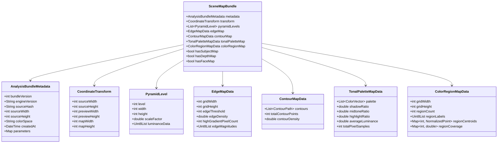

# RERANGER — SCENE MAP & ANALYSIS BUNDLE SPECIFICATION

**Document Version:** 1.0.0  
**Status:** **APPROVED & IMPLEMENTED**  
**Associated Prompts:** Prompt 14 (Implementation), Prompt 15 (Canvas Rendering & Interaction)  
**Cross-References:** [`docs/ENGINE_SPEC.md`](file:///root/reranger/docs/ENGINE_SPEC.md), [`docs/ARCHITECTURE.md`](file:///root/reranger/docs/ARCHITECTURE.md), [`AGENTS.md`](file:///root/reranger/AGENTS.md)

---

## 1. Overview & Architectural Mission

The **Scene Map / Analysis Bundle** is Reranger's deterministic, non-destructive intermediate visual analysis artifact. Generated during the intake pipeline (SCR-03) or lazily on project load, it provides spatial, structural, tonal, and palette metadata required by all three creative studios:
1. **Recolor Studio:** Uses `TonalPaletteMapData` and `ColorRegionMapData` for localized color remapping, palette clustering, and harmonic adjustments.
2. **Style & Render Studio:** Uses `EdgeMapData`, `ContourMapData`, and `PyramidLevel` multi-scale luminance for artistic contour ink rendering, edge-preserving stylization, and procedural grain blending.
3. **Humanize Studio:** Uses `CoordinateTransform` and `PyramidLevel` for spatial alignment and conditioning grids.

### Constitutional Invariants
- **Source Image Immutability (Invariant 4):** The source image is never mutated. Scene maps are derived read-only artifacts stored in the app-private SQLite database (`scene_map_cache` table) and memory cache.
- **Offline-First Execution (Invariant 5):** 100% computed on-device via background isolates (`IsolateSceneMapGenerator`). Zero cloud dependencies or network calls.
- **Truthful Capabilities (Invariant 7):** No fake semantic maps! `hasSubjectMap`, `hasDepthMap`, and `hasFaceMap` evaluate strictly to `false` when models are not loaded.
- **Memory & Thermal Headroom (Invariant 11):** Processing executes on downscaled preview grids ($\le 512\text{ px}$ max dimension). The engine drops full-resolution bitmaps immediately upon downscaling to prevent Android OOM kills.

---

## 2. Analysis Bundle Data Schema (v1.0.0)

A serialized bundle consists of seven structured sections:

---

## 3. Detailed Component Contracts

### 3.1 Normalized Coordinate Spaces & Transforms
All spatial data within Scene Maps is normalized to $[0.0, 1.0]$:
- Top-left: $(0.0, 0.0)$
- Bottom-right: $(1.0, 1.0)$

[`CoordinateTransform`](file:///root/reranger/lib/domain/scene_map/coordinate_transform.dart) provides bidirectional mapping between:
1. **Source Pixels:** $(0, 0)$ to $(W_s - 1, H_s - 1)$
2. **Preview Display Pixels:** $(0, 0)$ to $(W_p - 1, H_p - 1)$
3. **Map Grid Pixels:** $(0, 0)$ to $(W_m - 1, H_m - 1)$
4. **Normalized Space:** $(0.0, 0.0)$ to $(1.0, 1.0)$
5. **Viewport Display Layout:** Computes exact aspect-ratio preserved letterbox/pillarbox placement via `calculateFitLayout(viewportWidth, viewportHeight)`.

### 3.2 Multi-Scale Luminance Pyramid
Downsampled BT.601 integer luminance:
$$Y = (299 \cdot R + 587 \cdot G + 114 \cdot B) / 1000$$
- **Level 0 (Primary Preview):** Scale 1.0, max dimension $\le 512\text{ px}$.
- **Level 1 (Half Scale):** Scale 0.5, max dimension $\le 256\text{ px}$.
- **Level 2 (Quarter Scale):** Scale 0.25, max dimension $\le 128\text{ px}$.

### 3.3 3x3 Sobel Edge Gradients & Structural Contours
- **Edge Kernel:** 3x3 horizontal ($K_x$) and vertical ($K_y$) Sobel convolution with edge clamping.
  $$G = \text{clamp}\left(\sqrt{G_x^2 + G_y^2},\, 0,\, 255\right)$$
- **Edge Density:** Fraction of pixels where $G \ge \text{threshold}$ (default: 50).
- **Contour Extraction:** 8-connected perimeter tracing on thresholded boundary components, converted to continuous `ContourPath` vectors with normalized bounding boxes and arc lengths.

### 3.4 Dominant Harmonic Palette & Tonal Distribution
- **Median Cut Clustering (OP-05):** Subdivides RGB color boxes along maximal dynamic range channels to extract $K$ dominant centroids (default $K=5$).
- **Deterministic Canonical Ordering:** Centroids sorted strictly by ascending luminance with RGB tie-breaking.
- **Tonal Distribution:**
  - **Shadows:** $Y_{\text{norm}} < 0.25$
  - **Midtones:** $0.25 \le Y_{\text{norm}} < 0.75$
  - **Highlights:** $Y_{\text{norm}} \ge 0.75$
  - Invariant: $\text{shadowRatio} + \text{midtoneRatio} + \text{highlightRatio} = 1.0$.

### 3.5 Discrete Color Region Segmentation
- Maps Level 1 grid pixels to closest palette centroid via Euclidean distance:
  $$d^2 = (R - R_k)^2 + (G - G_k)^2 + (B - B_k)^2$$
- Computes spatial center of mass (`NormalizedPoint`) and coverage percentage for each color cluster.

---

## 4. Cache Key Determinism & Invalidation Matrix

Cache keys are computed using [`computeSceneMapCacheKey()`](file:///root/reranger/lib/data/scene_map/scene_map_cache_key.dart) by hashing a canonicalized string with SHA-256:

$$\text{Key} = \text{SHA256}\left(\text{"src:"} + \text{sourceHash} + \text{"|bv:"} + \text{bv} + \text{"|ev:"} + \text{ev} + \text{"|dim:"} + W \times H + \text{"|params:["} + \text{sortedParams} + \text{"]"}\right)$$

### Invalidation Matrix
| Dimension Changed | Effect | Rationale |
|---|---|---|
| **Source Image Bytes** | **Cache Miss** | New image has distinct SHA-256 source hash. |
| **Bundle Schema Version** | **Cache Miss** | Upgraded schema structure requires re-analysis. |
| **Engine / Algorithm Version** | **Cache Miss** | Improved Sobel/clustering implementation requires recomputation. |
| **Target Dimensions** | **Cache Miss** | Resized preview grid alters pixel sampling. |
| **Algorithm Parameter** (e.g. `edgeThreshold`, `paletteK`) | **Cache Miss** | Different slider settings yield different edge/cluster maps. |
| **Parameter Order** | **Cache Hit** | Order-independent parameter sorting guarantees stability. |
| **Unchanged Inputs & Settings** | **Cache Hit** | Reuses SQLite / memory cached bundle in $< 5\text{ ms}$. |

---

## 5. Approximation & Preservation Boundaries

| Visual Property | Preserved in Scene Map | Notes & Approximations |
|---|---|---|
| **High-Level Structural Geometry** | **YES** | Preserved via continuous contour paths and Sobel gradient magnitude landscape. |
| **Harmonic Color Relationships** | **YES** | Preserved via 5-point luminance-sorted palette centroids and tonal distribution. |
| **Spatial Color Boundaries** | **YES** | Preserved via discrete region segmentation labels on Level 1 grid. |
| **Full-Resolution Micro-Details** | **NO** | Scene maps operate on downscaled preview grids ($\le 512\text{ px}$) to preserve memory headroom. Raw pixel details remain intact in the immutable source image. |
| **Semantic Segmentation (Faces/Objects)** | **NO** | Subject/face/depth maps are unsupported without neural models and evaluate strictly to `false` (Invariant 7). |
